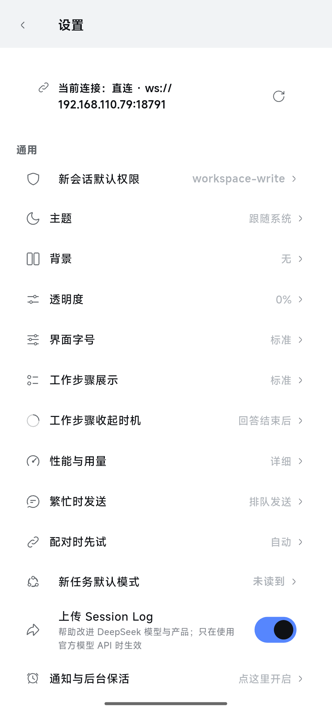
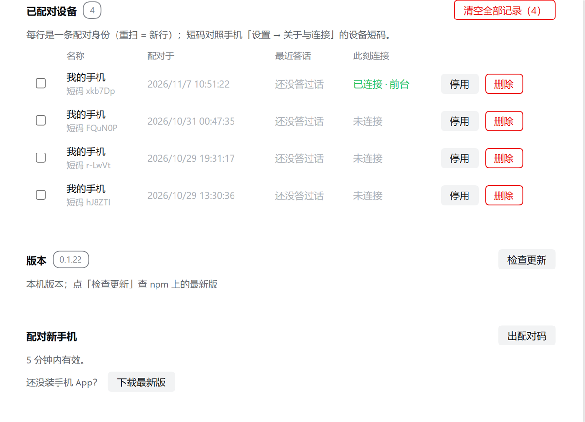

<p align="center"></p>

<h1 align="center">DSH Mobile</h1>

<p align="center">把 DeepSeek Harness 装进手机：手机端 App + 电脑侧插件 + 公网中转。</p>

<p align="center">
  <a href="https://github.com/Imzl-zl/deepseek-harness-mobile/actions/workflows/ci.yml"></a>
  <a href="https://github.com/Imzl-zl/deepseek-harness-mobile/releases"></a>
  <a href="https://www.npmjs.com/package/dsh-mobile-connector"></a>
  <a href="https://www.npmjs.com/package/dsh-mobile-connector"></a>
  <a href="https://www.npmjs.com/package/dsh-mobile-connector"></a>
  <a href="LICENSE"></a>
</p>

<p align="center">
  
  
</p>

<p align="center"><sub>手机端 <b>v0.2.13</b>：一个轮次里「思考」是折叠的一行、工具是逐张卡、正文始终可见；
设置页管连接与通用偏好。截图取自 v0.2.11（那之后这两屏没有可见改动），界面改了会一起换截图。</sub></p>

## 下载

| 你要装的东西 | 从哪拿 | 说明 |
|---|---|---|
| **手机 App** | [**最新 Release 的 APK**](https://github.com/Imzl-zl/deepseek-harness-mobile/releases/latest)（`dsh-mobile-vX.Y.Z.apk`） | release 签名，覆盖升级用同一个包；第一次装要允许「未知来源」 |
| **电脑侧插件** | `dsh plugin add dsh-mobile-connector`，或 Release 里的 `dsh-mobile-connector-X.Y.Z.tgz` | npm 上的版本带 SLSA provenance |

> 装了插件、打开侧边栏「手机」面板，在**配对新手机**那张卡下面就有一枚「下载最新版」按钮 ——
> 走到出码那一步时顺手就能把 App 装上，不用回来翻 README。

## 手机上能干什么

- **完整的会话**：对话、轨迹、改动卡、文件预览，不是网页缩略版。
- **思考与过程分层**：推理默认折成一行「思考过程」，工具逐张卡；正文永远在主线上，不会和思考混在一起。
  生成中过程保持展开，收口后按你的「收起时机」收起 —— 点一下轮次收口行就能展开。
- **审批与提问就地答**：DSH 的 composer takeover 原样搬过来，不用切回电脑。
- **子智能体与后台任务**：谁在跑、跑了多久、产出什么，一屏看完。
- **插件能管**：清单、逐行启停、按包卸载（"是不是内置、能不能卸"由电脑侧宿主判定，手机只显示它的原话）。
- **两种连法**：同局域网 / Tailscale 直连；出门在外走公网中转（端到端加密，中转只见密文与路由元数据）。
  中转是**选**出来的：内置一条开箱即用，也可以换成自己的。
- **一台手机记多台电脑**，同一时刻只服务一台（独占 1:1），切换是显式动作。
- **两端都能查更新**：设置页「检查更新」（App；启动时静默查一次）与电脑侧面板的「版本」卡
  （查 npm 上的最新插件版）。**只告诉你有没有新版，不自动装。**

## 组成

| 目录 | 是什么 | 安装方式 |
|---|---|---|
| `app/` | Flutter 手机端：连接层 + 会话界面 | 上面的 Release APK |
| `connector/` | DSH 插件：电脑侧网关 | npm，或 Release 的 `.tgz` |
| `relay/` | 公网中转（独立 Node 服务，无构建步骤） | `docker compose up -d` |
| `protocol/` | 通道协议：握手、AEAD、流控、恢复 | 被上面两者引用 |

<p align="center"></p>

<p align="center"><sub>电脑侧「手机」面板：已配对设备（停用 / 删除）、插件版本与查更新、出码配对 ——
下载 App 的入口也在这张卡上。上面还有连接（中转与令牌、直连端口）与通道与地址（逐条启停）。</sub></p>

## 快速开始

```bash
# 1. 电脑侧：装插件（profile 换成你自己的），在侧边栏「手机」面板里配中转、填令牌
dsh plugin --profile desktop add dsh-mobile-connector

# 2. 只在需要公网时：把 relay/ 起起来（也可以直接用内置的公共中转，跳过这步）
cd relay && docker compose up -d --build && docker compose logs -f relay

# 3. 手机：装 Release 的 APK → 扫电脑屏幕上的二维码
```

同一 WiFi 下不需要中转：出码时会带上局域网地址，手机优先走直连。
细节：[连接器与中转](docs/subsystems/connector-and-relay.md) · [部署中转](docs/cookbook/relay-on-a-server.md)

## 安全模型

- 手机**只信任二维码里带出的电脑公钥**，不接受网络下发的公钥。
- 每连接新密钥（前向保密）；配对秘密一次性，且不进中转。
- 中转只存 `sha256` 摘要（连接器 / 设备 / 管理令牌），只记元数据。
- 明文 `ws://` 仅限私网或用户显式确认；公网请用反代终结 TLS。

## 开发与门禁

| 命令 | 覆盖 |
|---|---|
| `node protocol/verify-{fixtures,loopback,vectors}.mjs` | 通道协议（跨端不变量：两侧实现必须相等） |
| `cd relay && pnpm typecheck && node --test` | 中转 |
| `cd connector && pnpm exec tsc --noEmit && pnpm build && pnpm test` | 电脑侧插件（fixtures 断言数须 = **454**、向量须 = **49**） |
| `node app/tools/verify-platform-boundary.mjs` | 多端边界 |
| `cd app && dart format --output=none --set-exit-if-changed lib test integration_test && dart analyze --fatal-infos lib test integration_test && flutter test` | 手机端 |

> **各项条数只写在一处：[`tools.md`](tools.md)。** 同一批数字抄在 README / `memory.md` / `tools.md`
> 三处就会漂，判据是"全绿"而不是"数字对上了"。

> `dart format` 是**先决条件**不是风格偏好：超宽的单行 `if (...) return ...;` 会被它折成
> 两行无括号形式，而 `curly_braces_in_flow_control_structures` 在 `--fatal-infos` 下就是红。
> 所以顺序永远是 **format → analyze → test**（CI 里同样是这个顺序，先红就没后面了）。

CI（[`ci.yml`](.github/workflows/ci.yml)）跑同一组命令；发版见 [release](docs/cookbook/release.md)：
`v*` 出 APK + 插件 tgz，`connector-v*` 发 npm。

## 文档

- 协议：[通道协议](docs/subsystems/remote-channel.md) · [配对 v2](docs/subsystems/pairing-v2.md)
- 端：[连接器与中转](docs/subsystems/connector-and-relay.md) · [手机端通道客户端](docs/subsystems/app-channel-client.md) · [轮组与折叠](docs/subsystems/turn-groups.md)
- 操作：[部署中转](docs/cookbook/relay-on-a-server.md) · [发版](docs/cookbook/release.md)

## 友链

<a href="https://linux.do" title="Linux.do —— 友善的技术社区"></a>

## License

[MIT](LICENSE)
