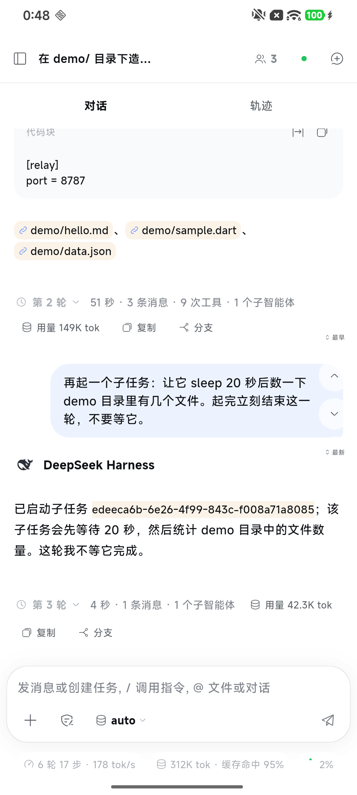
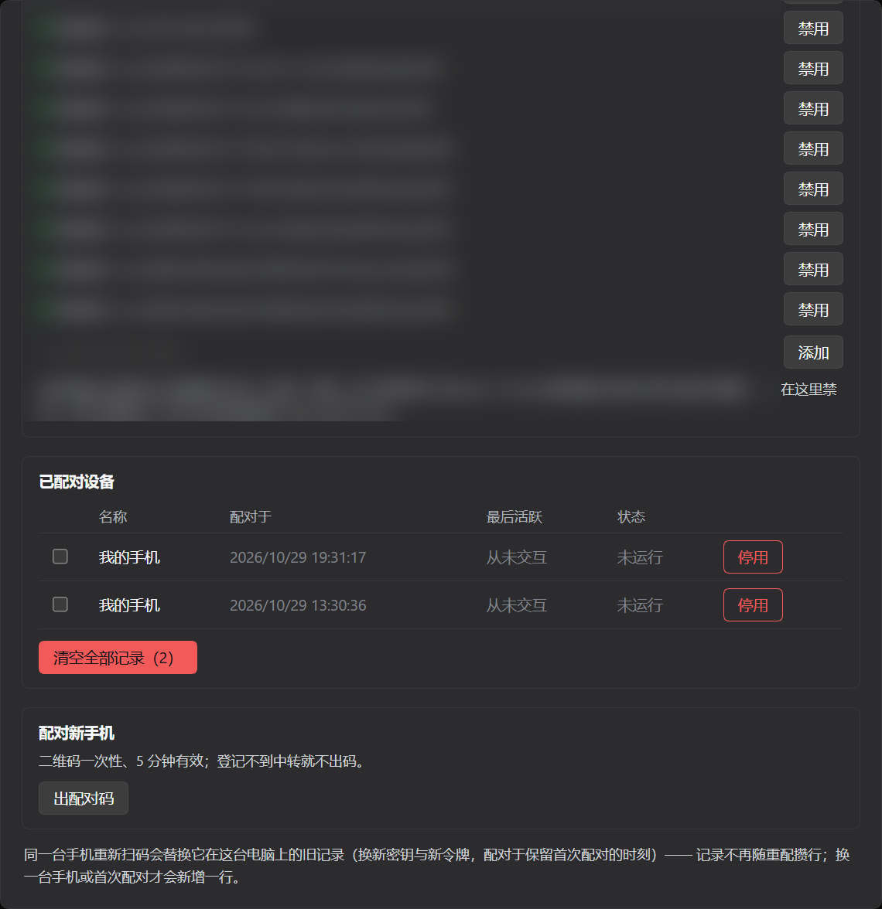

<p align="center"></p>

<h1 align="center">DSH Mobile</h1>

<p align="center">把 DeepSeek Harness 装进手机：手机端 App + 电脑侧连接器 + 公网中转。</p>

<p align="center">
  <a href="https://github.com/Imzl-zl/deepseek-harness-mobile/actions/workflows/ci.yml"></a>
  <a href="https://github.com/Imzl-zl/deepseek-harness-mobile/releases"></a>
  <a href="https://www.npmjs.com/package/dsh-mobile-connector"></a>
  <a href="LICENSE"></a>
</p>

<p align="center"></p>

## 在手机上用什么

- **完整的会话**：对话、轨迹、改动卡、文件预览，不是网页缩略版。
- **审批与提问就地答**：DSH 的 composer takeover 原样搬过来，不用切回电脑。
- **子智能体与后台任务**：谁在跑、跑了多久、产出什么，一屏看完。
- **两种连法**：同局域网/Tailscale 直连；出门在外走公网中转（端到端加密，中转只见密文与路由元数据）。
- **一台手机记多台电脑**，同一时刻只服务一台（独占 1:1），切换是显式动作。

## 组成

| 目录 | 是什么 | 安装方式 |
|---|---|---|
| `app/` | Flutter 手机端：连接层 + 会话界面 | Release 里的 APK |
| `connector/` | DSH 插件：电脑侧网关 | `dsh plugin add dsh-mobile-connector` |
| `relay/` | 公网中转（独立 Node 服务，无构建步骤） | `docker compose up -d` |
| `protocol/` | 通道协议：握手、AEAD、流控、恢复 | 被上面两者引用 |

<p align="center"></p>

<p align="center"><sub>电脑侧：「手机」面板里填中转、看在线设备、出配对码（地址已打码）</sub></p>

## 快速开始

```bash
# 1. 电脑侧：装插件，在「手机」面板填中转地址与令牌
dsh plugin --profile <名字> add dsh-mobile-connector

# 2. 中转（只在需要公网时）
cd relay && docker compose up -d --build && docker compose logs -f relay

# 3. 手机：装 Release 里的 APK，扫电脑屏幕上的二维码
```

细节：[连接器与中转](docs/subsystems/connector-and-relay.md) · [部署中转](docs/cookbook/relay-on-a-server.md)

## 安全模型

- 手机**只信任二维码里带出的电脑公钥**，不接受网络下发的公钥。
- 每连接新密钥（前向保密）；配对秘密一次性，且不进中转。
- 中转只存 `sha256` 摘要（连接器/设备/管理令牌），只记元数据。
- 明文 `ws://` 仅限私网或用户显式确认；公网请用反代终结 TLS。

## 开发与门禁

| 命令 | 覆盖 |
|---|---|
| `node protocol/verify-{fixtures,loopback,vectors}.mjs` | 通道协议 454 / 26 / 49 项 |
| `cd relay && pnpm typecheck && node --test` | 中转，132 项 |
| `cd connector && pnpm exec tsc --noEmit && pnpm build && pnpm test` | 插件，773 项 |
| `cd app && dart analyze --fatal-infos lib test integration_test && flutter test` | 手机端 |

CI（[`ci.yml`](.github/workflows/ci.yml)）跑同一组命令；每次 push 归档一版 debug APK。
发版见 [release](docs/cookbook/release.md)：`v*` 出 APK + 插件 tgz，`connector-v*` 发 npm。

## 文档

- 协议：[通道协议](docs/subsystems/remote-channel.md) · [配对 v2](docs/subsystems/pairing-v2.md)
- 端：[连接器与中转](docs/subsystems/connector-and-relay.md) · [手机端通道客户端](docs/subsystems/app-channel-client.md)
- 操作：[部署中转](docs/cookbook/relay-on-a-server.md) · [发版](docs/cookbook/release.md)

## 友链

<a href="https://linux.do" title="Linux.do —— 友善的技术社区"></a>

## License

[MIT](LICENSE)
