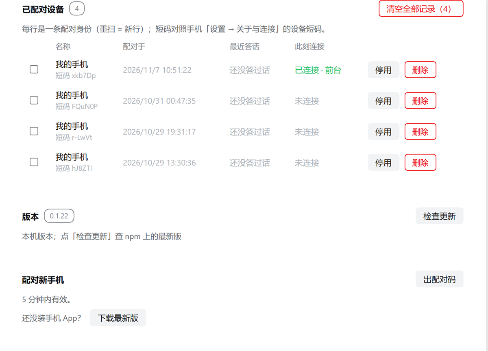

# dsh-mobile-connector

<a href="https://www.npmjs.com/package/dsh-mobile-connector"></a>
<a href="https://www.npmjs.com/package/dsh-mobile-connector"></a>
<a href="https://github.com/Imzl-zl/deepseek-harness-mobile/actions/workflows/ci.yml"></a>
<a href="https://github.com/Imzl-zl/deepseek-harness-mobile/blob/main/LICENSE"></a>

**DSH 插件：手机端远程通道的电脑侧网关。** 装进 [DeepSeek Harness](https://github.com/Imzl-zl/deepseek-harness-mobile) 之后，
手机扫码就能连到这台电脑 —— 对话、轨迹、改动卡、审批与提问、子智能体与后台任务，都在手机上。

<p align="center">
  
</p>

<p align="center"><sub>装好之后，DSH 侧边栏多一个「手机」入口：总览 · 连接 · 通道与地址 · 已配对设备 · 配对码 · 版本</sub></p>

---

## 要求

| 项 | 版本 |
|---|---|
| DSH | `>=0.2.1-rc.5 <0.2.2` |
| Node | `^22.19.0 \|\| >=24.0.0` |
| 对端 | 手机 App（[Release](https://github.com/Imzl-zl/deepseek-harness-mobile/releases) 里的 APK） |

## 安装

**两条通道，装哪个都行**（版本号可能不一致，见下）：

```bash
# ① npm（DSH 插件面板里按包名装 = 走这条）
dsh plugin --profile <profile> add dsh-mobile-connector

# ② GitHub Release 的 tgz（面板「安装」里也能直接粘这个 URL）
dsh plugin --profile <profile> add \
  https://github.com/Imzl-zl/deepseek-harness-mobile/releases/download/v0.2.3/dsh-mobile-connector-0.1.9.tgz
```

> **装完要重启一次 DSH**：插件热重载会让旧 fiber 先拆、新 fiber 再挂，
> 那一拍存储后端正在关，管理面可能挂不上（症状：面板 404、手机离线）。
> 新版已经对这一拍做了退避重试，但**当次**已经失败的那次挂载不会自己回来。

## 配置

三种写法等价，改哪个都生效（面板改的是 profile 的设置，不用重启）：

**A. 面板（推荐）** —— DSH 侧边栏「手机」→「连接」卡：

- **中转**：`内置中转`（开箱即用）/ `自定义`（填自己的中转根地址）
- **令牌**：粘贴中转的连接器令牌（只写不读，界面上不显示值）
- **直连**：`8790`（局域网点对点用；`0` = 不开）

**B. profile 的 `cordis.patch.yml`：**

```yaml
- id: dsh-mobile-connector
  config:
    relayUrl: wss://relay.example.com/ws/connector   # 连接器拨的地址，带 /ws/connector
    relayTokenRef: relay-connector                   # 指向 DSH 凭据面里的令牌
    listenPort: 8790                                 # 局域直连端口，0 = 不开
    listenHost: 0.0.0.0
```

**C. 环境 / 凭据面**：令牌本体走 DSH 的 `ctx.credentials`，配置里只放**引用名**（`relayTokenRef`）。

> **地址形状容易搞错**：电脑侧这条是**连接器拨的**，带 `/ws/connector`；
> 手机侧拿到的是**根地址**，它自己拼 `/ws-ticket` 与 `/ws/device?ticket=`。

## 面板能做什么

| 区块 | 能做的事 |
|---|---|
| 总览 | 中转状态 · 在线台数 · 直连端口，一眼判断"这台电脑现在通不通" |
| 连接 | 选中转（内置 / 自定义）、写令牌、开/关直连端口，卡头直接保存 |
| 通道与地址 | 逐条启停（中转拨号 / 直连监听）· 删除不再上报的网卡地址（可恢复）· 追加一条不在枚举里的地址（Tailscale 这类） |
| 已配对设备 | 停用 / 启用 · 接管（换掉正在服务的那台）· **删除**（在用的也行：先停用拿终态，再抹记录） |
| 配对新手机 | 出二维码（5 分钟有效，同一台手机重扫替换旧记录） |
| 版本 | 当前插件版本 ·「检查更新」（电脑代查 npm 的 `latest`；查不到会说原因，不冒充"已是最新"） |

**停 ≠ 卸载**：停传输不清凭据、不动身份，再启动不用重扫。**断开 ≠ 解绑**：删设备才需要重新配对。

## 它怎么工作

- **两条链路**：一条控制连接接收路由与名册通知；每台设备再拨一条独立数据连接。
- **端到端加密**：每条连接现场协商密钥（X25519 + AEAD），手机只信任二维码里带出的电脑公钥；中转只转发密文与路由元数据。
- **方法白名单**：只暴露列出的方法；审批 / 提问 / 任务走同一条通道，不另开端口。
- **独占 1:1**：同一时刻只服务一台设备，被拒的那台会收到占用者的名字（面板里可以「接管」）。

## 排错

| 症状 | 多半是 |
|---|---|
| 面板整块红、出码报 `HTTP 404: not found` | 管理面没挂上（装插件后的热重载那一拍）。**重启一次 DSH** |
| 手机显示"端点点拨不通" | 电脑不在线 / 换了网络。局域网直连要 `listenPort` 开着且同网段 |
| 中转一直是"连接中" | `relayUrl` 少了 `/ws/connector`、或令牌不对（中转会 401） |
| 手机上「检查更新」有新版但装不上 | 手机装的是 debug 签名包，与 Release 的正式签名不同 —— 只能卸载重装 |

## 开发与门禁

```bash
cd connector
pnpm exec tsc --noEmit     # 类型
pnpm build                 # 产出 lib/（插件入口）
pnpm test                  # 825 项
node --check client.js     # 浏览器半侧是手写 JS，没有类型检查
```

协议与设计文档：`docs/subsystems/connector-and-relay.md`、`docs/subsystems/remote-channel.md`（在仓库里）。

## 链接

[仓库](https://github.com/Imzl-zl/deepseek-harness-mobile) ·
[连接器与中转](https://github.com/Imzl-zl/deepseek-harness-mobile/blob/main/docs/subsystems/connector-and-relay.md) ·
[通道协议](https://github.com/Imzl-zl/deepseek-harness-mobile/blob/main/docs/subsystems/remote-channel.md) ·
[自建中转](https://github.com/Imzl-zl/deepseek-harness-mobile/blob/main/docs/cookbook/relay-on-a-server.md)

## License

[MIT](https://github.com/Imzl-zl/deepseek-harness-mobile/blob/main/LICENSE)
