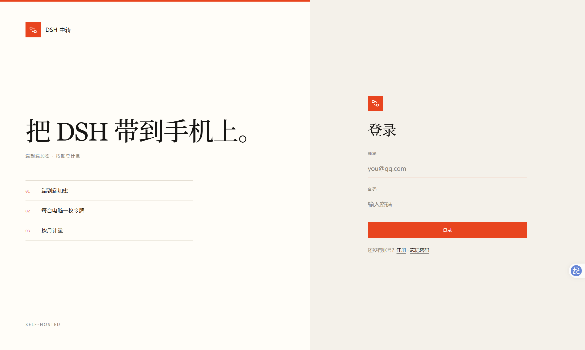
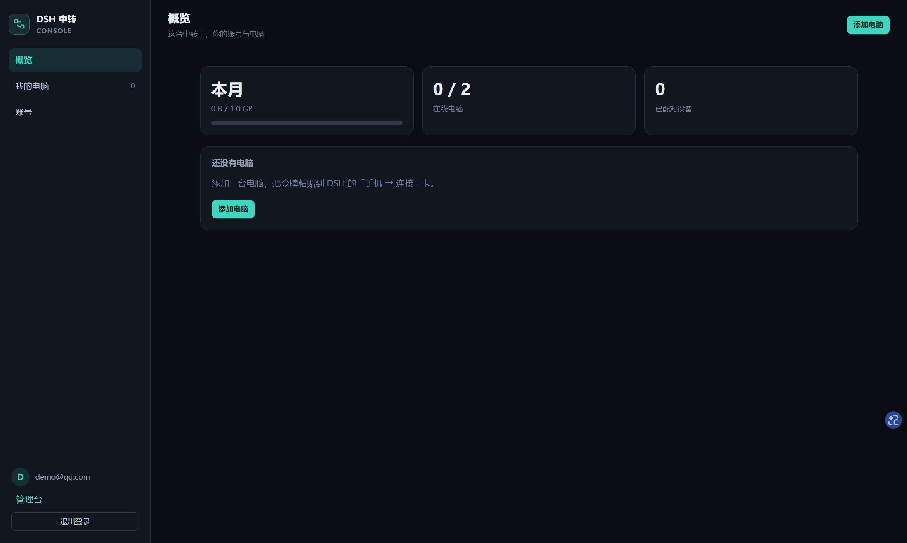
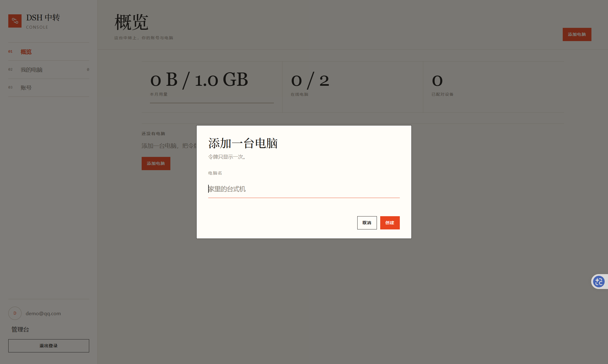
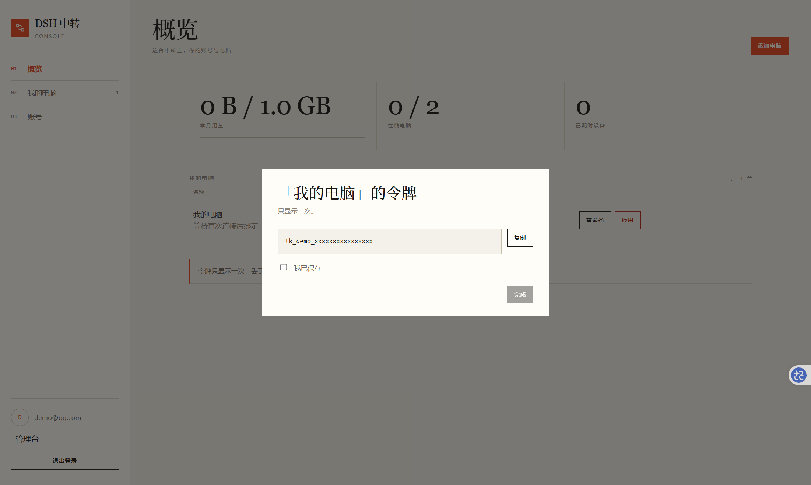
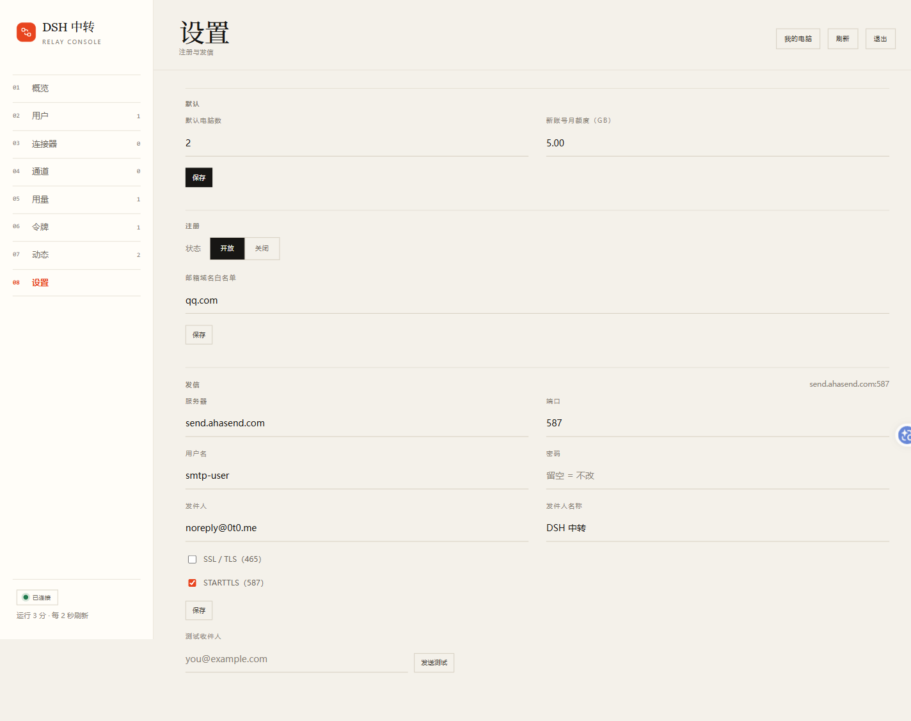
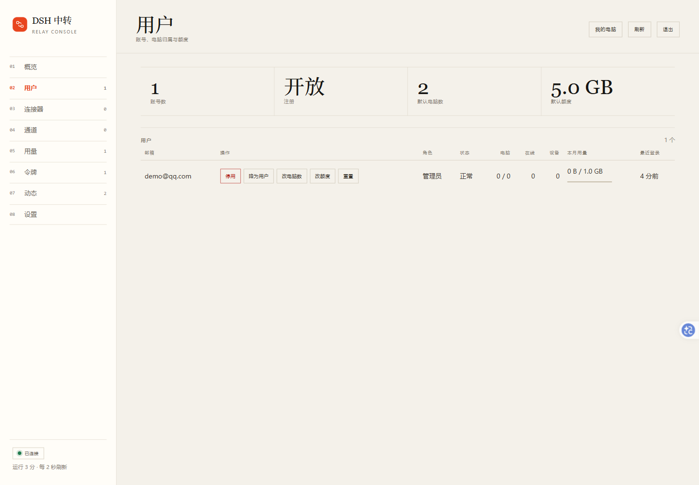
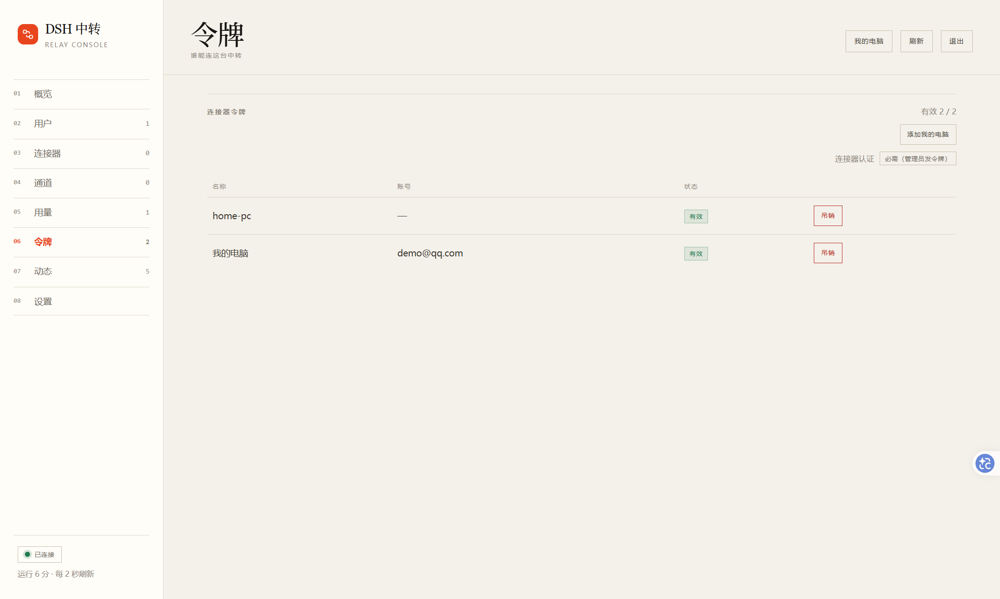

# 中转账号与准入

> 契约见 `remote-channel.md`(协议)与 `connector-and-relay.md`(转发与桥接)。本文只写中转自带的账号层:谁有几台电脑、能用多少流量、怎么登录。

## 1. 定位

公开中转的准入层,顺序是:**注册/登录 → 账号拥有电脑 → 电脑令牌首次连接时绑定 → 按账号限电脑数与月流量**。

- **手机不登录**:设备身份仍由电脑侧签发(配对 v2),中转只存摘要。账号只回答"谁有几台电脑、能用多少流量",不参与设备握手。
- 中转仍**不存会话内容**;新增的持久物只有账号、会话、邀约/验证码(仅内存)与审计元数据。
- 不写 `auth` 段时,中转走匿名兑换、没有登录页;写了 `auth` 段即账号模式。

## 2. 配置

`relay.config.json` 里出现 `auth` 段即账号模式。此时 `connectorAuth` **必须是 `"required"`**;写成 `"open"` 启动失败(`main.ts` 的账号段校验)。

| 字段 | 默认 | 说明 |
|---|---|---|
| `mode` | `"accounts"` | 只接受这个值;存在 `auth` 段即开启 |
| `baseUrl` | — | 公网根地址。决定 cookie 的 Secure 与邮件里的绝对链接 |
| `dbPath` | `<配置目录>/data/relay.db` | SQLite 文件;**挂目录,不挂单文件**(WAL 会生成 `-wal` / `-shm`) |
| `serverName` | `DSH 中转` | 登录页与邮件标题 |
| `registration.mode` | `"open"` | `open` / `closed`;`closed` 只挡注册,不挡密码重置 |
| `registration.maxAccounts` | `null` | 已注册账号数上限(`COUNT(*) FROM users`,**含 suspended**);`null` = 不限;到上限时注册页整页置灰,发码 403、注册 409 |
| `registration.requireEmailVerification` | `true` | 开启时必须有 `smtp` |
| `registration.emailDomains` | `[]` | 空 = 不限;当前部署是 `["qq.com"]` |
| `limits.defaultMaxConnectors` | `2` | 每个账号的电脑数;`users.max_connectors` 可单人覆盖 |
| `limits.defaultQuotaBytes` | `5 GiB` | 注册时写进该用户;`null` = 不限 |
| `adminEmails` | `[]` | 用这些邮箱注册的账号直接成为管理员 |
| `trustProxy` | `false` | 反代后按 `X-Real-IP` / `X-Forwarded-For` 取来源地址 |
| `sessionDays` | `30` | 会话有效期 |
| `smtp.*` | — | `host` / `port` / `secure` / `starttls` / `user` / `pass` / `from` / `fromName`;`pass` 可写 `env:RELAY_SMTP_PASS` |

## 3. 身份与数据

- `users`:id `u_…`、邮箱唯一、scrypt 密码摘要、`role`(`admin`/`user`)、`status`(`active`/`suspended`)、`max_connectors`(`null` = 用默认)、`quota_bytes`(`null` = 不限;注册时把默认值落成具体数字)、创建/最近登录时间。
- `sessions`:id `s_…`、`token_hash`、过期时间、IP/UA、`revoked_at`。CSRF 值由 `HMAC(库密钥, sessionId)` 派生,不另存一列。
- `tokens`(仍在 `relay.config.json`):新增 `userId` / `connectorId` / `name` / `createdAt`。控制台签发的令牌 id 是随机 `tk_…`,旧令牌的 id 仍等于连接器 id。
- 设备名册(`devices`)不变:中转只存摘要与展示字段,设备令牌仍由电脑侧签发。

## 4. 流程

### 4.1 注册、登录、重置

- 验证码 6 位、10 分钟、5 次尝试、60 秒重发;按 IP 与邮箱分桶限流。
- 密码 scrypt(N=16384, r=8, p=1),长度 10–200;登录失败统一 `bad-credentials`,邮箱不存在时也算一次 dummy 摘要。
- 登录失败**连续 5 次锁该来源地址 15 分钟**(lockout.ts,与 /admin 认证失败共用一份计数);锁定期内连正确密码也不放行,成功一次清零,到期自动放行;lockout.failures: 0 关闭。锁定按 
emoteAddress 算 —— 反代后面要按真实 IP 分桶,得先配好信任边界。
- 会话 cookie:`dsh_relay_session`(HttpOnly、SameSite=Lax),CSRF 双提交 `dsh_relay_csrf`;`Secure` 只在请求 Host 等于 `baseUrl` 的 host 时加,本地 `127.0.0.1` 调试不会被浏览器拒收。
- 注册成功即登录;密码重置会吊销该账号全部会话;改密码保留当前会话、吊销其它会话。
- **注册名额**:`registration.maxAccounts` 到上限后三处一起拦 —— `/api/auth/config` 的 `registration.full`(页面据此一进来就置灰)、发码 403 `registration-full`(别让人拿到码才失败)、注册 409 `registration-full`(兜底裁决在"数一遍 + 插入"的同一个事务里,并发注册只有一个能拿到最后一个位置)。口径是**含 suspended** 的账号总数:停用不是注销,"停用→再注册"不能绕过名额。
- `closed` 与 `full` 是**两种状态**:`closed` 优先、各自的状态码与文案;两者都**不影响登录、已登录用户与密码重置**。
- **Linux.do 未接**:当前没有 OAuth 路由;`auth` 段不读 OAuth 配置。

### 4.2 电脑令牌与首连绑定

- 登录用户在 `/console` 创建电脑:服务端检查 `max_connectors`,生成随机 id `tk_…`,把 `userId` / `name` / `createdAt` 写进配置并加入内存表。明文令牌只回一次。
- 电脑第一次拨 `/ws/connector?id=<pcId>` 时,中转把该令牌的 `connectorId` 绑成 `pcId` 并写回配置;之后 `?id=` 必须一致,不一致 403。
- 旧令牌(id 就是 connectorId)不触发绑定,行为不变。
- 控制台可重命名、停用、恢复、删除(先停用再删除)、重置绑定(仅离线电脑)。停用会立刻收掉控制面与通道。

### 4.3 限额

- **电脑数**在创建令牌与 `max_connectors` 读取处判定;降低上限不踢已有电脑,要立刻收线用管理员"停用账号"。
- **月流量**由 `metering` 按 `user:<id>` 记账;上限优先读 `users.quota_bytes`(注册时落默认值),`null` = 不限。`enforce: "cut"` 时用满会以 4003 `rate-limited quota` 收掉该账号所有通道。
- **账号停用**:`status = suspended` 后新的控制面/数据面升级回 403,已在线的连接由 `closeUser` 立刻收掉。
- **手机数不做上限**:每台电脑本来就只服务一台手机(1:1),账号共享的带宽上限仍由电脑数与月流量决定。

## 5. HTTP 面

| 方法 | 路径 | 说明 |
|---|---|---|
| GET | `/login` `/register` `/reset` | 认证页(单文件内联) |
| GET | `/console` | 用户控制台;未登录 302 到 `/login` |
| GET | `/api/auth/config` | 注册开关、允许域名、服务名与名额是否已满（`registration.full`）（无密钥） |
| POST | `/api/auth/email-code` | 发验证码;注册/重置共用,重置不泄露邮箱是否存在 |
| POST | `/api/auth/register` `/login` `/logout` | 注册 / 登录 / 退出 |
| GET | `/api/auth/me` | 当前用户与 CSRF 值 |
| POST | `/api/auth/password` `/password/reset` | 改密码 / 用验证码重置 |
| GET/POST | `/api/auth/sessions` `/sessions/revoke` | 会话清单与吊销 |
| GET | `/api/console/state` | 控制台快照(用户、限额、电脑、设备、用量) |
| POST | `/api/console/connectors` | 新建电脑,返回只显示一次的令牌 |
| POST | `/api/console/connectors/action` | `rename` / `revoke` / `restore` / `remove` / `reset-binding` |

管理面新增 `/admin/api/users/{status,role,limits}`、`/admin/api/limits-defaults`、`/admin/api/mail/test`、`/admin/api/smtp`、`/admin/api/registration` 与 `/admin/api/tokens/issue`;账号会话(`role = admin`)与 break-glass Bearer 都能进 `/admin`。

## 6. 存续、备份与部署

- SQLite 用 WAL;`relay/docker-compose.yml` 挂 `./data:/config/data`。**不要**把 `relay.db` 单文件挂进容器,否则 `-wal` / `-shm` 写不进去。
- 备份:停容器后复制 `data/` 目录,或 `sqlite3 data/relay.db ".backup '/path/backup.db'"`;不要在运行中只复制 `.db` 单文件。
- `PRAGMA user_version = 1`;版本高于本进程时拒绝打开并报错。
- `node:sqlite` 在 Node 24 仍会打一行 `ExperimentalWarning`;镜像与 CI 都用 Node 24。`relay/package.json` 的 engines 已抬到 `>=22.13`(unflagged 的起点)。
- 反代必须保留 Host,并建议覆盖 `X-Real-IP`(见 `relay/Caddyfile.example`);否则在线状态与按 IP 限流会把所有客户端塌成一个地址。

## 7. 邮件与自检

- `--check-smtp [--to <地址>]`:只连 SMTP、做 STARTTLS/隐式 TLS 与 AUTH,然后发一封自检邮件;不读账号库、不起监听。部署时先跑它。
- AhaSend 的 `from` 必须落在**已校验的域名**上(当前是 `0t0.me`,不是 `dsh.0t0.me`);域名未校验时 `MAIL FROM` 会回 `556 Tenant or Domain not found`。
- 管理台「设置」可直接改 SMTP、注册开关/邮箱域名、默认电脑数与新账号默认月额度:保存先写回 `relay.config.json`,再改运行时策略,不用重启容器;密码留空 = 保持原值。
- `--promote <已注册邮箱>`:把已有账号提升为管理员;不把密码放命令行。

## 8. UI

- 认证页与用户控制台共用 `relay/src/ui/theme.ts` 的设计 token;视觉为纸张底色 + 衬线标题 + 细线分隔 + 单色强调,亮/暗跟随系统。单文件内联、无外链、CSP 维持 `default-src 'none'`。
- 登录页:左品牌、右表单;注册/重置共用一张壳,按路径显示字段。
- 控制台:概览 / 我的电脑 / 账号;空状态一句话;添加电脑后令牌弹窗必须勾选"已保存"才能关闭。
- 管理台:`/admin` 的"用户"分区显示账号、角色、状态、电脑/在线/设备数、本月用量(带用量条)、最近登录;每行「操作」列可直接改电脑数、改额度、重置用量,并停用/恢复、改角色。
- 管理台「设置」:默认电脑数、新账号默认月额度、SMTP 服务器/端口/TLS/用户名/密码/发件人,以及注册开放/关闭、注册名额上限与邮箱域名白名单;保存即写回配置并立即生效,密码留空 = 不改。
- **管理台令牌页可以签一张 break-glass 令牌**:「添加我的电脑」调 `POST /admin/api/tokens/issue`,id 预填 `local`(连接器的默认 `?id=`,换过 id 的电脑要填它自己的),同 id 已有活跃令牌回 409;明文只在应答里出现一次,配置里只落摘要,审计只记 id。账号会话与 Bearer 两种登录都能用。
- **这张令牌不归属任何账号**:它 `userId` 为空,**不占任何账号的电脑数**;在「用量」分区出现在「未归属账号的主体」表里,而不是某个用户行下。它是一张能连中转的钥匙,不是某个人的电脑。
- 顶栏「我的电脑」按登录方式换落点:账号会话进 `/console`(完整的账号电脑管理);Bearer 模式直接落到令牌页并聚焦「添加我的电脑」那行 —— 令牌模式没有 cookie,`/console` 会静默 302 到 `/login`。
- 管理台"用量"分区:账号数 / 本月总用量 / 在线电脑 / 已配对设备四个 KPI;按已用降序列出全部账号(含零用量)、额度条、最近登录,并可改额度或重置;**未归属账号的主体(旧令牌 / 没配 owner)单独一张表**,不会因为开了账号模式就从面板消失。
- 电脑侧「连接」卡的令牌行有「去注册 / 登录」外链:按当前 `relayUrl` 推导 `http(s)://host/login`,`/login` 已登录会 302 到 `/console`;取舍见 `.agents/notes/implemented/2026-11-02-connection-card-opens-relay-console.md`。









## 9. 已知边界

- 没有 Linux.do、邀请码、等待名单、邮箱换绑、用户自删除;注册只有 `open` / `closed` 两档加一个名额上限(`maxAccounts`),没有按邮箱域或按 IP 的配额。
- 旧令牌与管理台签出的 break-glass 令牌都**不归属任何账号**,仍可用;管理台能看与吊销,但不能在 UI 里"归属给某账号"。
- 单实例:会话与限流都在进程内,多实例会各限一份。
- 验证码只在内存,重启即失效;用户需要重新发码。
- 手机端不登录;如果以后要"手机也要登录",会与配对 v2 的设备身份重复,需要重画配对流程。

## 10. 验证

```pwsh
cd relay
pnpm exec tsc --noEmit -p tsconfig.json
node --test                                  # 当前 173 条
node src/main.ts --config relay.config.json --check-smtp   # 需要 auth.smtp
```

浏览器冒烟:登录 → 控制台 → 添加电脑(令牌只显示一次)→ `/admin` 用户视图。2026-11-02 在本机 `http://127.0.0.1:8787` 实测通过。
